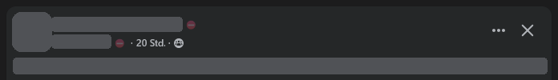
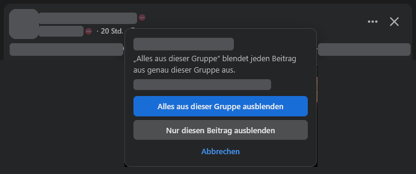
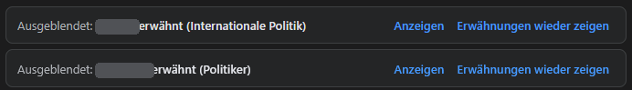
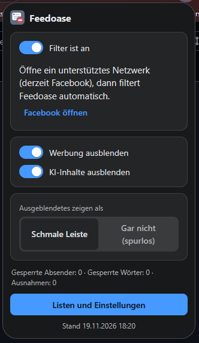
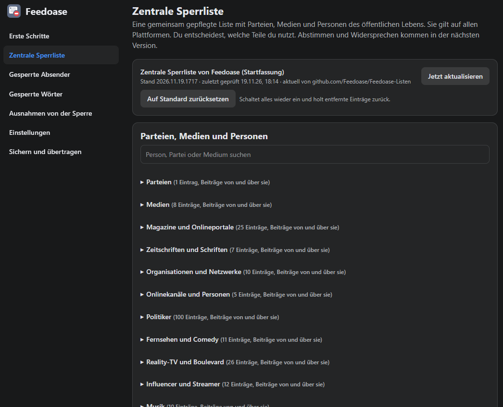

# Feedoase: Zentrale Sperrliste

Hier liegt die gemeinsame Sperrliste der Browsererweiterung **Feedoase**. Feedoase blendet in sozialen Netzwerken Beiträge und Kommentare aus, die man nicht sehen möchte. Derzeit funktioniert das auf Facebook, Instagram und TikTok sind vorbereitet.

Die Liste steht in einer einzigen Datei: `sperrliste.json`.

## Was die Liste macht

- Sie enthält Parteien, Medien, Organisationen und bekannte Personen, aufgeteilt in Gruppen.
- Wer Feedoase nutzt, sieht Beiträge dieser Absender nicht mehr. Auf Wunsch verschwinden auch Beiträge anderer, die einen dieser Absender nur erwähnen.
- Zu Beginn sind alle Gruppen eingeschaltet. In den Einstellungen von Feedoase lässt sich jede Gruppe und jeder einzelne Eintrag abschalten.
- Wer einen bestimmten Absender trotz der Liste sehen will, trägt ihn unter „Ausnahmen von der Sperre“ ein.

## Was die Liste nicht macht

- Niemand wird gesperrt, gemeldet oder gelöscht. Die Liste wirkt nur im Browser der Person, die Feedoase nutzt. Alle anderen sehen Facebook unverändert.
- Ein Eintrag bedeutet nur, dass Nutzer diesen Absender mit einem Schalter ausblenden können.
- Feedoase sendet keine Daten. Beim Herunterladen der Liste sieht GitHub nur die IP-Adresse, wie bei jedem Aufruf einer Webseite.

## So sieht es aus

In den Bildern aus Facebook sind Namen, Profilbilder und Beitragstexte grau abgedeckt.

### ⛔ neben jedem Absender



Neben jedem Namen im Kopf eines Beitrags steht ein kleines ⛔. Bei einem Beitrag in einer Gruppe sind es zwei: eines neben dem Namen der Gruppe und eines neben der Person, die geschrieben hat. So lässt sich wählen, ob die ganze Gruppe verschwinden soll oder nur diese Person.

### Fenster nach dem Klick auf ⛔



- Oben stehen der Name der Gruppe und eine kurze Erklärung.
- Darunter steht die Adresse der Gruppe. An dieser Adresse erkennt Feedoase die Gruppe, nicht am angezeigten Namen. Zwei Gruppen mit gleichem Namen werden deshalb nicht verwechselt.
- **Alles aus dieser Gruppe ausblenden:** Ab jetzt verschwindet jeder Beitrag aus dieser Gruppe.
- **Nur diesen Beitrag ausblenden:** Nur dieser eine Beitrag verschwindet.
- **Abbrechen:** Das Fenster schließt sich, nichts ändert sich.

Diese Sperren legt jeder Nutzer für sich selbst an. Sie landen nicht in dieser Liste.

### Hinweise auf ausgeblendete Beiträge



An der Stelle eines ausgeblendeten Beitrags steht eine schmale graue Leiste mit dem Grund. „*Name* erwähnt (Internationale Politik)“ heißt: Der Beitrag stammt nicht von dieser Person, erwähnt sie aber. Sie steht in der Gruppe „Internationale Politik“, und bei dieser Gruppe sind die Erwähnungen eingeschaltet.

- **Anzeigen** zeigt nur diesen einen Beitrag an.
- **Erwähnungen wieder zeigen** schaltet die Erwähnungen der ganzen Gruppe ab. Beiträge, die jemanden aus dieser Gruppe nur erwähnen, erscheinen dann wieder. Beiträge der Personen selbst bleiben ausgeblendet.

### Fenster hinter dem Symbol



Ein Klick auf das Feedoase-Symbol in der Browserleiste öffnet dieses Fenster:

- **Filter ist an:** schaltet Feedoase ganz ein oder aus. Ist gerade kein unterstütztes Netzwerk offen, steht darunter ein Link zu Facebook.
- **Werbung ausblenden** und **KI-Inhalte ausblenden:** zwei eigene Schalter, unabhängig von der Sperrliste.
- **Ausgeblendetes zeigen als:** „Schmale Leiste“ zeigt an der Stelle des Beitrags die graue Leiste mit dem Grund. „Gar nicht (spurlos)“ lässt den Beitrag ohne Hinweis verschwinden.
- Darunter steht, wie viele eigene Sperren und Ausnahmen angelegt sind.
- **Listen und Einstellungen** öffnet die Einstellungen.

### Einstellungen der Zentralen Sperrliste



- Links stehen die Bereiche der Einstellungen: Erste Schritte, Zentrale Sperrliste, Gesperrte Absender, Gesperrte Wörter, Ausnahmen von der Sperre, Einstellungen, Sichern und übertragen.
- Oben steht, welche Fassung der Liste geladen ist, wann Feedoase zuletzt nach einer neuen gesucht hat und woher sie kommt (dieses Repository).
- **Jetzt aktualisieren** sucht sofort nach einer neuen Fassung.
- **Auf Standard zurücksetzen** schaltet alles wieder ein und holt selbst entfernte Einträge zurück.
- Darunter stehen die Gruppen mit der Zahl ihrer Einträge. „Beiträge von und über sie“ heißt: Beide Schalter der Gruppe sind an. Ein Klick auf eine Gruppe klappt sie auf, dort lassen sich die Schalter und einzelne Einträge abschalten.
- Über das Suchfeld findet man eine Person, eine Partei oder ein Medium direkt.

## Gruppen der Liste

Parteien · Medien · Magazine und Onlineportale · Zeitschriften und Schriften · Organisationen und Netzwerke · Onlinekanäle und Personen · Politiker · Fernsehen und Comedy · Reality-TV und Boulevard · Influencer und Streamer · Musik · Sport · Unternehmer · Verbände und Gewerkschaften · Internationale Politik · Historische Personen

Jede Gruppe hat zwei Schalter:

1. **Beiträge von ihnen ausblenden:** Beiträge, die diese Personen, Seiten oder Medien selbst veröffentlichen, und Links auf ihre Webseiten.
2. **Erwähnungen:** Beiträge anderer, in denen ihr Name vorkommt, auch Berichte und Kritik über sie.

## Wie Feedoase einen Eintrag erkennt

- **Profilnummer:** Jedes Profil auf Facebook hat eine feste Nummer. Ist sie bekannt, erkennt Feedoase den Absender nur noch daran. Namensvettern und Fanseiten bleiben dann sichtbar.
- **Name:** Solange keine Nummer bekannt ist, zählt der angezeigte Name. Bei Personen muss er genau passen, bei Medien reicht der Anfang (zum Beispiel alles, was mit „BILD“ beginnt).
- **Nur mit Haken:** Bei häufigen Namen gilt der Eintrag nur für Profile mit dem blauen Verifizierungshaken.
- **Webadressen:** Beiträge mit Links auf die genannten Seiten werden ebenfalls ausgeblendet.
- **Erwähnungen:** Jede Gruppe hat eine Wortliste. Feedoase sucht ganze Wörter und übliche Wortformen (ein Name findet auch die Form mit angehängtem „s“), aber keine Wortteile. Wörter wie „Bild“ oder „Welt“ zählen nur in der Schreibweise der Zeitung („BILD“, „WELT“).

## Wie neue Fassungen ankommen

- Feedoase prüft alle 30 Minuten, ob hier eine neue Fassung liegt, und lädt sie nur dann herunter.
- Die Version steht in der Datei (`Jahr.Monat.Tag.StundeMinute`). Eine Fassung, die älter ist als die in Feedoase mitgelieferte, wird nicht übernommen.
- Ist GitHub nicht erreichbar, nutzt Feedoase die mitgelieferte Startliste.

## Eigene Liste verwenden

Wer eine eigene Liste im selben Format pflegt, trägt deren https-Adresse in Feedoase ein: Einstellungen, Zentrale Sperrliste, „Für Fortgeschrittene“.

## Aufbau der Datei

Für alle, die die Liste lesen oder eine eigene bauen wollen.

| Feld | Inhalt |
|---|---|
| `format` | Formatversion, derzeit `1` |
| `version` | Stand der Liste, steigt mit jeder Änderung |
| `name` | Name der Liste |
| `categories` | Die Gruppen: Kennung und angezeigter Name |
| `entries` | Die Einträge (siehe unten) |
| `wordLists` | Die Wortlisten für Erwähnungen, eine je Gruppe |
| `hashed` | Profile, die nur als Prüfsumme gespeichert sind, damit kein Name lesbar ist |

Ein Eintrag:

```json
{
  "id": "bild",
  "name": "BILD",
  "category": "medium",
  "keys": [],
  "namePatterns": ["^BILD\\b"],
  "domains": ["bild.de"]
}
```

| Feld | Inhalt |
|---|---|
| `id` | Feste Kennung des Eintrags |
| `name` | Angezeigter Name in Feedoase |
| `category` | Gruppe aus `categories` |
| `keys` | Profilnummern oder Profilnamen mit Plattform, etwa `fb:id:123456`, `fb:u:profilname`, `fb:g:gruppe` |
| `names` | Genaue Namen, bei Personen auch andere Schreibweisen |
| `namePatterns` | Namensmuster als regulärer Ausdruck, wahlweise mit `flags` (`"i"` = Groß- und Kleinschreibung egal) |
| `domains` | Webadressen; Links darauf werden ausgeblendet |
| `verifiedOnly` | `true`: gilt nur für Profile mit Verifizierungshaken |

Ein Wort in `wordLists`:

| Feld | Inhalt |
|---|---|
| `text` | Das Wort oder die Wortgruppe |
| `mode` | `forms`: Wort mit üblichen Endungen (Standard). `exact`: nur genau so. `prefix`: alle Wörter, die so beginnen |
| `case` | `true`: Groß- und Kleinschreibung muss genau stimmen |

Gehashte Einträge sind die ersten 16 Zeichen von `SHA-256("<salt>:<schlüssel>")` in Hexadezimalschreibweise, der Schlüssel mit Plattform wie bei `keys`.
